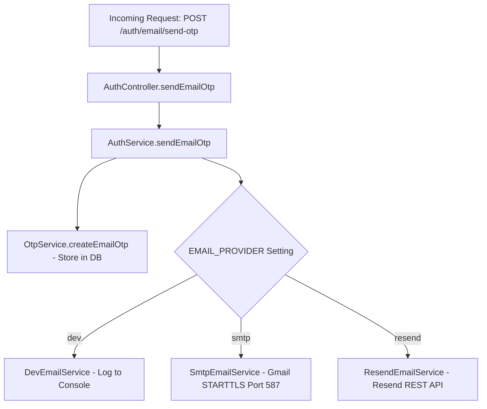

# FOODIGO TASK 14 — GMAIL SMTP EMAIL OTP DELIVERY REPORT

**Repository:** `FoodiGo`  
**Execution Timestamp:** 2026-10-11T23:05:00+05:30  
**Status:** **B. SMTP IMPLEMENTED, CREDENTIALS NOT CONFIGURED**  

---

## 1. Executive Summary & Root Cause Analysis

### Identified Root Cause
During verification of the email OTP authentication flow, the API reported `{"success": true, "message": "OTP sent successfully"}` for `POST /auth/email/send-otp`, yet no verification email arrived in the recipient's inbox.

Investigation identified the following two root causes:
1. **Development Provider Active:** The environment was operating with `EMAIL_PROVIDER="dev"`. Under this configuration, `DevEmailService` solely writes generated OTPs to the developer console log (`[DEV EMAIL OTP] For ...: ...`) and never attempts real outbound network delivery.
2. **Missing SMTP Implementation:** The codebase previously contained only two email provider classes: `DevEmailService` (local console logger) and `ResendEmailService` (Resend REST API). No SMTP or Nodemailer provider existed to support Gmail or custom mail servers.

### Remediation Overview
- Implemented `SmtpEmailService` utilizing **Nodemailer** configured for Gmail SMTP (`smtp.gmail.com`, port 587, STARTTLS).
- Registered `SmtpEmailService` in `AuthModule` dependency injection and configured provider selection (`EMAIL_PROVIDER="smtp"`).
- Added comprehensive environment validation in `env.validation.ts` and `configuration.ts` to require SMTP settings when `EMAIL_PROVIDER="smtp"`.
- Prevented false-success responses: transport rejections, authentication failures, and timeouts now throw clear exceptions, and diagnostic logs sanitize all secrets and passwords.
- Created 13 unit tests for the SMTP provider (using mocked Nodemailer transports) and added an E2E test verifying provider failure responses.
- Verified zero test regressions across all 377 unit tests and 85 E2E tests.

---

## 2. Files Modified & Added

| File | Status | Description |
|---|---|---|
| `foodgo-backend/package.json` | Modified | Added `nodemailer` dependency and `@types/nodemailer` devDependency |
| `foodgo-backend/package-lock.json` | Modified | Locked dependency tree with audited Nodemailer packages |
| `foodgo-backend/src/modules/auth/services/smtp-email.service.ts` | **Created** | Implemented `SmtpEmailService` implementing `IEmailProvider` via Nodemailer |
| `foodgo-backend/src/modules/auth/services/smtp-email.service.spec.ts` | **Created** | 13 comprehensive unit tests covering config validation, mock send, timeouts, auth failure, and password redaction |
| `foodgo-backend/src/modules/auth/auth.module.ts` | Modified | Registered `SmtpEmailService` and added `EMAIL_PROVIDER="smtp"` factory logic |
| `foodgo-backend/src/config/configuration.ts` | Modified | Added `email.smtp` interface and runtime mapping |
| `foodgo-backend/src/config/env.validation.ts` | Modified | Added validation rules for `SMTP_HOST`, `SMTP_PORT`, `SMTP_USER`, `SMTP_PASS`, and `EMAIL_FROM` |
| `foodgo-backend/src/config/env.validation.spec.ts` | Modified | Added unit tests verifying SMTP environment validation rules |
| `foodgo-backend/test/app.e2e-spec.ts` | Modified | Added E2E test verifying send-OTP returns 500 error on provider failure |
| `foodgo-backend/.env.example` | Modified | Documented Gmail SMTP variables using safe placeholders |

---

## 3. Provider Selection Architecture

The `EMAIL_PROVIDER` factory in `AuthModule` determines the active email dispatch mechanism:



### Provider Behavior Matrix
| Provider Name | Setting | Target | Behavior | Production Allowed? |
|---|---|---|---|---|
| Development | `EMAIL_PROVIDER="dev"` | Terminal console | Logs OTP to console; zero network calls | ❌ **Strictly Forbidden** |
| Gmail SMTP | `EMAIL_PROVIDER="smtp"` | `smtp.gmail.com:587` | Sends via Nodemailer with STARTTLS & App Password | ✅ **Allowed** |
| Resend API | `EMAIL_PROVIDER="resend"` | `api.resend.com` | Sends via Resend HTTP REST API | ✅ **Allowed** |

---

## 4. Environment Variables Required for Gmail SMTP

To activate Gmail SMTP delivery for local testing, set the following variables in `foodgo-backend/.env`:

```env
# Activate SMTP Provider
EMAIL_PROVIDER="smtp"

# Gmail SMTP Configuration
SMTP_HOST="smtp.gmail.com"
SMTP_PORT=587
SMTP_SECURE=false
SMTP_USER="your-email@gmail.com"
SMTP_PASS="your-16-character-google-app-password"
EMAIL_FROM="FoodiGo <your-email@gmail.com>"
```

> [!IMPORTANT]
> **Gmail App Password Required:**
> A regular Google Account password will NOT work. Google requires an **App Password**:
> 1. Go to your Google Account: [https://myaccount.google.com/](https://myaccount.google.com/)
> 2. Navigate to **Security** and enable **2-Step Verification** (if not already enabled).
> 3. Search for **App passwords** (or go to [https://myaccount.google.com/apppasswords](https://myaccount.google.com/apppasswords)).
> 4. Create a new app password (e.g. named "FoodiGo Backend").
> 5. Copy the generated 16-character password and set it as `SMTP_PASS` in your `.env`.

---

## 5. Security & Sanitization Precautions

1. **No Credentials in Source Code:** Zero secrets, passwords, or tokens are hardcoded.
2. **Never Exposed in Client Bundles:** SMTP configuration is strictly backend-only and never exposed to the Expo / React Native customer application.
3. **Password Redaction in Error Logs:** If Gmail rejects a request or returns an error containing credential strings, `SmtpEmailService.sanitizeErrorMessage()` replaces the password with `***REDACTED***`.
4. **No Raw OTP Leakage:** Neither the OTP nor raw user passwords are logged in error outputs.
5. **No Real Emails in Test Suites:** All automated tests use mocked transporters; no external SMTP connections are initiated during tests.

---

## 6. Test Suite Execution & Verification Results

### Summary of Results
- **Backend Unit Tests:** **377 / 377 passed** (31 test files, exit code 0)
- **Backend E2E Tests:** **85 / 85 passed** (4 test files, exit code 0)
- **Backend TypeScript Compilation (`tsc -p tsconfig.build.json --noEmit`):** **0 errors** (exit code 0)
- **Customer App TypeScript Compilation (`tsc --noEmit`):** **0 errors** (exit code 0)
- **Git Whitespace Check (`git diff --check`):** **0 errors** (exit code 0)

### Key Test Coverage Highlights
- `smtp-email.service.spec.ts`:
  - `initializes with correct Gmail SMTP settings` (PASS)
  - `identifies missing SMTP_USER as unconfigured` (PASS)
  - `identifies missing SMTP_PASS as unconfigured` (PASS)
  - `identifies missing EMAIL_FROM and falls back to user` (PASS)
  - `handles custom or invalid SMTP_PORT by falling back to 587` (PASS)
  - `fails at startup in production when EMAIL_PROVIDER=smtp and credentials are missing` (PASS)
  - `dispatches email OTP successfully with correct sender and recipient` (PASS)
  - `rejects with InternalServerErrorException when service is unconfigured` (PASS)
  - `handles SMTP send rejection (rejected recipient) with BadRequestException` (PASS)
  - `handles SMTP authentication failure (535 Bad Credentials)` (PASS)
  - `handles SMTP connection timeout cleanly` (PASS)
  - `sanitizes error logging to ensure SMTP password is never leaked` (PASS)
  - `isolates DevEmailService from production` (PASS)
- `env.validation.spec.ts`:
  - `accepts valid SMTP configuration` (PASS)
  - `throws when SMTP_HOST is missing` (PASS)
  - `throws when SMTP_PORT is invalid` (PASS)
  - `throws when SMTP_USER is missing` (PASS)
  - `throws when SMTP_PASS is missing` (PASS)
  - `throws when EMAIL_FROM is missing with SMTP` (PASS)
  - `throws when SMTP credentials contain mock in production` (PASS)
  - `accepts valid production SMTP email configuration` (PASS)
- `app.e2e-spec.ts`:
  - `handles provider delivery failure without false success` (PASS)

---

## 7. Local Diagnostics & Verification Workflow

### 1. Verify Nodemailer Installation
```bash
node -e "import('nodemailer').then(m => console.log('Nodemailer available:', typeof m.default.createTransport));"
```

### 2. Verify Presence of SMTP Environment Variables (Without Printing Secrets)
```bash
node --input-type=module -e "
import dotenv from 'dotenv';
dotenv.config();
console.log('EMAIL_PROVIDER:', process.env.EMAIL_PROVIDER || 'not set');
console.log('SMTP_HOST set:', Boolean(process.env.SMTP_HOST));
console.log('SMTP_PORT set:', Boolean(process.env.SMTP_PORT));
console.log('SMTP_USER set:', Boolean(process.env.SMTP_USER));
console.log('SMTP_PASS set:', Boolean(process.env.SMTP_PASS));
console.log('EMAIL_FROM set:', Boolean(process.env.EMAIL_FROM));
"
```

### 3. Rebuild the Backend
```bash
cd /Users/muhammedabbas/FoodiGo/foodgo-backend
npm run build
```

### 4. Restart the Development Server
```bash
npm run start:dev
```

### 5. Send a Controlled Test OTP Request
Once you have added your Gmail credentials to `foodgo-backend/.env`, trigger an OTP delivery:
```bash
curl -i -X POST http://localhost:3000/auth/email/send-otp \
  -H "Content-Type: application/json" \
  -d '{"email":"your-test-email@example.com"}'
```

---

## 8. Final Status Declaration

**Status: B. SMTP IMPLEMENTED, CREDENTIALS NOT CONFIGURED**

The complete Gmail SMTP transport, dependency injection, environment validation, error handling, password sanitization, and automated unit/E2E tests are implemented and passing. To receive real OTP emails in your inbox, set `EMAIL_PROVIDER="smtp"`, `SMTP_USER`, and `SMTP_PASS` in your local `.env` and restart the backend dev server.
